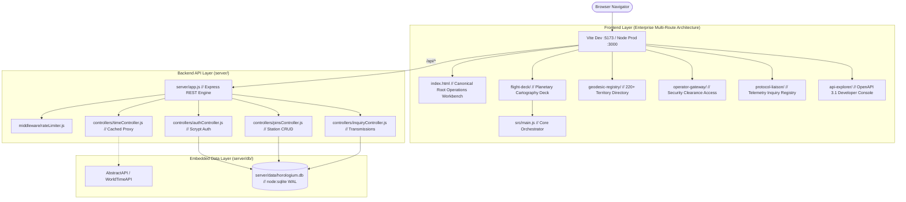

<p align="center">
  
</p>

# HOROLOGIUM // Global Temporal & Meridian Telemetry System

> **A tier-1 interactive world timezone atlas, UTC meridian tracker, and temporal telemetry platform engineered with Swiss horological precision, embedded SQLite persistence, and an isolated Node.js API runtime.**

[](https://vitejs.dev/)
[](https://nodejs.org/)
[-003B57?style=flat&logo=sqlite&logoColor=white)](https://nodejs.org/api/sqlite.html)
[](https://www.docker.com/)
[](LICENSE)

---

## 1. System Overview

**Horologium** (named after the southern constellation *Horologium Oscillatorium* / "The Pendulum Clock") is a mature, low-latency temporal telemetry platform designed as an intermediate, production-ready system for high-reliability single-engineer operations.

- **Zero-Latency Client-Side Engine:** Native `Intl.DateTimeFormat` and IANA timezone computation eliminate latency and third-party API rate-limiting.
- **Embedded SQLite Persistence (`node:sqlite`):** Native, zero-C++ dependency, embedded database managing operator clearances, persistent custom stations, and transmission logs.
- **Secure Server-Side Time Proxy (`/api/time`):** Eliminates browser API key exposure with in-memory 60-second TTL caching and server-side fallback.
- **Cryptographic Operator Clearance (`/api/auth`):** Native HMAC-SHA256 session tokens with scrypt-salted password hashes.
- **Astronomical Solar Terminator:** Dynamic mathematical solar declination and subsolar meridian projection rendering the real-time day/night shadow boundary.
- **24-Hour Mechanical Time Scrubber:** 96-tick radio scale tuner with a 1px Vermilion needle enabling instant simulated time travel.
- **Bento Telemetry Matrix:** Docked multi-zone horological cells featuring dynamic working hours (09:00–17:00) daylight status ribbons.
- **Geodesic Command Palette (`Cmd+K`):** Fuzzy query search across 220+ sovereign territories and IANA identifiers.

---

## 2. Full-Stack Production Architecture



---

## 3. Directory Structure

```text
horologium/
├── .github/
│   └── workflows/
│       └── ci.yml             # Automated CI pipeline (Build, Lint & Health Check)
├── .vscode/
│   ├── settings.json          # Workspace formatting rules
│   └── extensions.json        # Recommended toolchain
├── public/
│   ├── assets/                # Icons & vector assets
│   ├── favicon.svg            # Meridian monogram favicon
│   ├── robots.txt             # Search engine crawler policies
│   └── sitemap.xml            # Geodesic XML sitemap
├── server/
│   ├── controllers/
│   │   ├── authController.js  # Scrypt password hashing & HMAC session tokens
│   │   ├── inquiryController.js # Transmission registry logger
│   │   ├── pinsController.js  # Pinned telemetry stations CRUD
│   │   └── timeController.js  # Server-side API proxy with 60s memory cache
│   ├── data/
│   │   └── horologium.db      # Embedded SQLite database (Ignored by Git)
│   ├── db/
│   │   └── database.js        # Native node:sqlite connection, schema & seeds
│   ├── middleware/
│   │   ├── authMiddleware.js  # Operator Bearer token guard
│   │   └── rateLimiter.js     # Sliding window rate limiter
│   ├── routes/
│   │   └── api.js             # Central REST routing table
│   └── app.js                 # Express app setup & production static server
├── src/
│   ├── api/
│   │   ├── httpClient.js      # Centralized fetch wrapper with abort timeout
│   │   └── timeService.js     # Client API client with proxy & Intl fallback
│   ├── components/
│   │   ├── clock/             # ScrubberController & TelemetryMatrix
│   │   ├── map/               # MapController (SVG, Graticules, Terminator)
│   │   └── ui/                # CommandPalette (Cmd+K) & NavigationHeader
│   ├── config/                # env.js & constants.js
│   ├── data/                  # countries.data.js (220 nations)
│   ├── pages/                 # Legacy zero-breakage forwarders
│   ├── styles/                # tokens.css, base.css, layout.css, main.css
│   ├── utils/                 # dom.js, router.js, timeMath.js, sntpClient.js
│   └── main.js                # Primary application bootstrap
├── flight-deck/               # Canonical Vector & 3D WebGL Flight Deck (index.html)
├── geodesic-registry/         # 220+ Sovereign Nations & IANA Offsets (index.html)
├── operator-gateway/          # Security Clearance Level-01 Session Portal (index.html)
├── protocol-liaison/          # Enterprise Telemetry Ingestion Registry (index.html)
├── api-explorer/              # OpenAPI 3.1 Interactive Specification (index.html)
├── .env                       # Local secrets (NEVER COMMITTED)
├── .env.example               # Committed template defining required keys
├── .gitignore                 # Production-grade Git ignore rules
├── docker-compose.yml         # Container orchestration manifest
├── Dockerfile                 # Multi-stage production container build
├── index.html                 # Single Unified Root Operations Workbench
├── package.json               # Scripts: dev, dev:server, dev:client, build, start
├── server.js                  # Production server entrypoint
├── vite.config.js             # Multi-page build & enterprise route proxy configuration
└── README.md                  # Comprehensive architectural reference
```

---

## 4. REST API Reference

| Endpoint | Method | Clearance | Description |
|---|---|---|---|
| `/api/health` | `GET` | Public | Telemetry health: uptime, SQLite connection, server UTC time |
| `/api/time?location=:loc` | `GET` | Public | Cached proxy to atomic time service with fallback |
| `/api/auth/login` | `POST` | Public | Authenticates callsign/cipher; returns signed clearance token |
| `/api/auth/me` | `GET` | Operator | Returns session details for current token |
| `/api/auth/logout` | `POST` | Operator | Revokes operator clearance token |
| `/api/pins` | `GET` | Public | Returns ordered pinned telemetry stations |
| `/api/pins` | `POST` | Operator | Pins a new station to the global horology matrix |
| `/api/pins/:id` | `DELETE` | Operator | Removes a pinned station |
| `/api/transmissions` | `POST` | Public | Logs a message to the Horologium registry (Rate-limited) |
| `/api/transmissions` | `GET` | Operator | Retrieves incoming telemetry transmissions |

---

## 5. Local Setup & Production Execution

### Prerequisites
- **Node.js 24+** (includes native `node:sqlite`)
- **npm 10+**

### Development (Frontend + Backend concurrently)
```bash
# 1. Install dependencies
npm install

# 2. Run both Vite (:5173) and Express API (:3001) with live proxy
npm run dev
```

### Standalone Production Server
```bash
# 1. Compile optimized multi-page client bundle
npm run build

# 2. Launch production server (Serves dist/ and /api on port 3001)
npm start
```

### One-Command Docker Deployment
```bash
docker compose up -d
```
Access the application at `http://localhost:3000/`.

---

## 6. One-Time Workspace Directory Rename Note

Because the IDE holds open file locks on the root folder while running:
1. Close the workspace in your IDE (`File > Close Folder`).
2. Rename the directory from `onmap-timezones.html` to `horologium`.
3. Re-open the newly named folder `horologium` in your IDE.

---

## 7. License

Distributed under the MIT License. Built with Swiss horological discipline by **Shaik Imthiyas**.