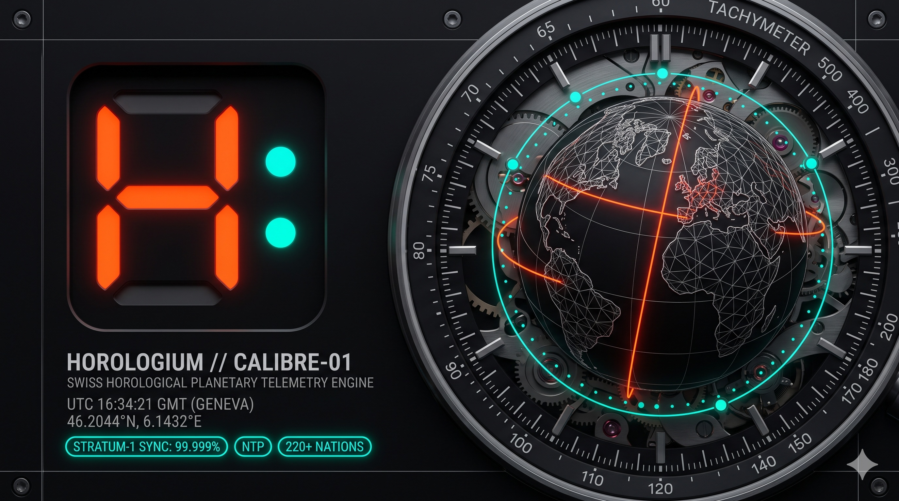

<p align="center">
  
</p>

# HOROLOGIUM // Planetary Time & Meridian Telemetry Architecture

> **An enterprise-grade, high-precision distributed chronometry system, Swiss horological planetary tourbillon, interactive world timezone atlas, UTC meridian tracker, and developer API platform engineered with Swiss horological precision, multi-engine persistence (Turso LibSQL, TimescaleDB & SQLite WAL), and an isolated Node.js API runtime.**

<p align="center">
  <a href="https://github.com/shaikimthiyas/horologium/actions/workflows/ci.yml">
    
  </a>
  
  
  
  
  
  
  
  
  <a href="LICENSE">
    
  </a>
</p>

---

## 1. System Overview

**Horologium** (named after the southern constellation *Horologium Oscillatorium* / "The Pendulum Clock") is a production-grade, distributed temporal telemetry platform and developer ecosystem engineered for low-latency operations, mathematical clock consensus, Swiss horological visualization, and seamless enterprise integration.

- **Swiss Horological Planetary Tourbillon (`/`):** Procedural SVG horology featuring a precision logarithmic tachymeter bezel, 12 faceted baton markers, exposed skeleton calibre gears with synthetic ruby jewel bearings (`#E11D48`), 60-second clockwise orbital time ring, and a centerpiece 3D Geodesic Globe canted at a $23.44^\circ$ diagonal axial tilt with West-to-East prograde rotation and spring-physics inertia drag.
- **Dedicated Hero Workbench (`/horo/`):** 3-Zone Hick's Law navigation header, Fitts's Law $\ge 44\text{px}$ touch targets, real-time astronomical solar terminator, 24-hour mechanical chrono-slider with Snap-to-Live atomic sync, meeting overlap planner, and 220+ sovereign nation directory.
- **Universal Client SDK (`@horologium/client`):** Zero-dependency TypeScript/ESM/CJS library for sub-millisecond atomic clock sync, timezone calculations, meeting overlap matrices, and astronomical solar positions.
- **W3C Custom Element Micro-Widgets (`<horologium-clock>`, `<horologium-overlap>`):** Drop-in autonomous web components for any SaaS, portal, or web platform.
- **Interactive Developer Portal & Widget Studio (`/developers/`):** Visual widget designer, instant API key provisioning, live platform telemetry, and code generation across HTML, React, Vue, Svelte, Node.js, Python, Go, and cURL.
- **Enterprise Browser Extension (Manifest V3):** Instant browser action popup for Chromium-based browsers (Chrome, Edge, Brave, Arc) with live atomic time and meeting overlap planner.
- **API Key Governance & Multi-Tier Rate Limiting:** Cryptographic `hlg_live_*` API keys, tenant rate limiting tiers (Community 60 RPM, Developer 300 RPM, Enterprise 1,200 RPM, Sovereign Unlimited), and RFC 7807 Problem Details error formatting.
- **Zero-Latency Client-Side Chronometry:** Native `Intl.DateTimeFormat` and IANA database indexing eliminate third-party API rate limits and network dependency.
- **Astronomical Solar Day/Night Terminator:** Real-time dynamic recalculation of solar declination and subsolar meridian coordinates across 2D Mercator SVG cartography and 3D WebGL spherical globe with Civil, Nautical, and Astronomical twilight bands.
- **Marzullo Truechimer Consensus:** Multi-source atomic NTP evaluation filtering out rogue falsetickers to compute tight, provable intersection bounds.
- **Continuous Clock Slewing (Linux `adjtime` Emulation):** Smooth sub-millisecond drift adjustment preventing backwards time discontinuities.
- **Tri-Engine Persistence Architecture:** Native edge support for **Turso (LibSQL)**, enterprise **TimescaleDB / PostgreSQL 16**, and embedded high-performance **SQLite (WAL mode)** with in-memory test isolation.
- **Progressive Web App (PWA) Offline Engine:** Service Worker pre-caching with Network-First navigation, synthetic offline API telemetry, and **TCXO quartz drift simulation ($\pm 0.035\text{ ppm}$)**.
- **OpenAPI 3.1 Interactive Sandbox & Swagger UI:** Dual-mode developer explorer (`/api-explorer/`) featuring live execution against all endpoints and a downloadable Postman collection (`/horologium.postman_collection.json`).
- **Human-Factors & WCAG 2.2 AAA Compliance:** Mathematical contrast ratios ($\ge 7:1$), Fitts's law touch targets ($\ge 44\text{px}$), optical halation smoothing, and global accessible keyboard hotkeys.

---

## 2. Canonical Operational Consoles & Services

Horologium is structured as an enterprise multi-page architecture with specialized consoles and services accessible via direct URLs and persistent navigation:

| Console / Service | Canonical Route | Primary Function | Shortcut / Access |
| :--- | :--- | :--- | :---: |
| **Swiss Tourbillon Intro** | [`/`](index.html) | Calibre-01 3D planetary tourbillon, ruby jewels, 7-segment H: display | <kbd>Space</kbd> / <kbd>Esc</kbd> |
| **Hero Workbench** | [`/horo/`](horo/index.html) | Mission dashboard, atomic dial, overlap planner, solar terminator | <kbd>1</kbd> |
| **Developer Portal & Studio** | [`/developers/`](developers/index.html) | Widget studio, SDK quickstarts, API key provisioning, live metrics | Direct / Nav |
| **Flight Deck** | [`/flight-deck/`](flight-deck/index.html) | 3D WebGL globe & 2D Mercator cartography deck with dynamic terminator | <kbd>2</kbd> |
| **Geodesic Registry** | [`/geodesic-registry/`](geodesic-registry/index.html) | Sovereign meridian atlas and fuzzy query search across 220+ territories | <kbd>3</kbd> |
| **Operator Gateway** | [`/operator-gateway/`](operator-gateway/index.html) | Cryptographic clearance, telemetry station manager, database persistence | <kbd>4</kbd> |
| **Protocol Liaison** | [`/protocol-liaison/`](protocol-liaison/index.html) | Transmission log dispatch, radio-frequency inquiries, operator inbox | <kbd>5</kbd> |
| **API Explorer** | [`/api-explorer/`](api-explorer/index.html) | OpenAPI 3.1 Swagger UI sandbox, live latency tester, Postman download | <kbd>6</kbd> |
| **Standalone Embed: Clock** | `/embed/clock` | Responsive zero-friction iframe embed for world clock displays | Embed API |
| **Standalone Embed: Overlap** | `/embed/overlap` | Responsive zero-friction iframe embed for meeting overlap planning | Embed API |
| **Browser Extension** | `extension/` | Manifest V3 Chrome/Edge extension popup for instant time synchronization | Browser Action |

---

## 3. High-Level System Architecture

```mermaid
graph TD
    User([🌐 Browser / Recruiter / Enterprise SaaS]) --> Gateway[Vite Dev :5173 / Node Gateway :3001]

    subgraph "Frontend Layer (Calibre-01 Sovereign HUD)"
        Gateway --> Intro[Swiss Horological Tourbillon<br/>• 3D Geodesic Slanted Globe (23.44°)<br/>• Procedural SVG Calibre & Ruby Jewels<br/>• 7-Segment H: Sapphire Display]
        Intro --> Workbench[Hero Workbench Console (/horo/)<br/>• 3-Zone Hick's Law Nav<br/>• 24h ChronoSlider & Solar Terminator<br/>• Meeting Overlap Matrix Planner]
        Workbench --> DevPortal[Developer Portal & Studio (/developers/)<br/>• Visual Widget Configurator<br/>• API Key Provisioning Engine<br/>• Multi-Language Code Generator]
        Workbench --> PWA[Service Worker v1.4.0<br/>• Network-First HTML Navigation<br/>• Offline Cache-First Assets<br/>• TCXO Quartz Drift Simulation]
        Workbench --> FSM[ClockFSM Finite State Machine<br/>• 7 Deterministic States<br/>• Monotonic adjtime Slewing]
    end

    subgraph "Enterprise Developer Ecosystem"
        Gateway --> SDK["@horologium/client SDK (TypeScript / ESM / CJS)"]
        Gateway --> WebComponents["W3C Custom Elements (<horologium-clock>, <horologium-overlap>)"]
        Gateway --> EmbedRoutes["Standalone Embeds (/embed/clock, /embed/overlap)"]
        Gateway --> ChromeExt["Manifest V3 Browser Extension (Chrome / Edge)"]
    end

    subgraph "Backend API Gateway (server/app.js)"
        Gateway -- "/api/v1/*" --> ExpressApp[Express REST API Gateway]
        ExpressApp --> Auth[Enterprise API Key Middleware<br/>• SHA-256 Hash Verification<br/>• Tenant Tier Rate Limiting]
        ExpressApp --> Validator[Zod Schema Validator & RFC 7807 Details]
        ExpressApp --> Probes[Kubernetes Probes<br/>• /healthz, /readyz, /startupz]
        ExpressApp --> Metrics[Prometheus OpenMetrics Exposition<br/>• /metrics]
        ExpressApp --> SntpWS[WebSocket SNTP Server<br/>• RFC 4330 / RFC 5905]
    end

    subgraph "Consensus & Tri-Engine Persistence"
        ExpressApp --> Marzullo[Marzullo Truechimer Engine<br/>• Multi-NTP Intersection Consensus]
        ExpressApp --> TriDB[(Tri-Engine Persistence)<br/>• Turso LibSQL Cloud at Edge<br/>• TimescaleDB / PostgreSQL 16<br/>• Embedded SQLite WAL Mode]
    end
```

---

## 4. Enterprise Developer & Business Layer

### A. Universal Client SDK (`@horologium/client`)
Install via npm or load directly via CDN:
```bash
npm install @horologium/client
```
```javascript
import { HorologiumClient } from '@horologium/client';

const client = new HorologiumClient({
  apiKey: 'hlg_live_your_api_key_here',
  endpoint: 'https://horologium.io/api'
});

// 1. Stratum-1 Atomic Time Synchronization
const sync = await client.getAtomicTime();
console.log(`Synchronized UTC: ${sync.utc} (Round-Trip Latency: ${sync.rttMs}ms)`);

// 2. 24-Hour Business Overlap Matrix
const overlap = client.calculateOverlap('America/New_York', 'Asia/Tokyo');
console.log(`Time Difference: ${overlap.differenceHours}h | Shared Overlap: ${overlap.goldenOverlapHours.length}h`);

// 3. Astronomical Solar Coordinates
const solar = client.getSolarPosition();
console.log(`Solar Declination: ${solar.declinationDeg}° | Subsolar Lon: ${solar.subsolarLonDeg}°`);
```

### B. W3C Custom Element Micro-Widgets
Embed zero-friction, autonomous widgets into any web application or CMS with a single `<script>` tag:

```html
<!-- Load Horologium Widget Suite -->
<script src="https://horologium.io/widgets/horologium-widgets.js" async></script>

<!-- 1. Enterprise World Clock Widget -->
<horologium-clock 
  zone="Asia/Tokyo" 
  format="24h" 
  seconds="true" 
  theme="obsidian">
</horologium-clock>

<!-- 2. Meeting Overlap Planner Widget -->
<horologium-overlap 
  base-zone="Europe/London" 
  remote-zone="America/New_York" 
  theme="silver">
</horologium-overlap>
```

### C. Standalone Embeddable Micro-Frontends (iFrames)
Distraction-free, responsive embed routes for Notion, Jira, internal dashboards, and SaaS platforms:
```html
<iframe 
  src="https://horologium.io/embed/clock?zone=America/Los_Angeles&theme=dark" 
  width="320" 
  height="140" 
  frameborder="0" 
  style="border-radius: 12px; overflow: hidden;">
</iframe>
```

### D. Chrome & Edge Browser Extension (Manifest V3)
Located in `extension/`, this enterprise browser extension provides:
- Live Stratum-1 atomic time in the browser toolbar.
- Quick timezone converter across 220+ territories.
- One-click meeting overlap finder.
- Direct links to Developer Portal and API Explorer.

### E. API Key Governance & Multi-Tier Rate Limiting
- **Cryptographic Key Generation:** Keys follow the `hlg_live_<hex32>` format.
- **Deterministic Storage:** Keys are hashed using SHA-256; plain-text keys are never stored.
- **Tenant Rate Tiers:**
  - `community`: 60 requests/minute
  - `developer`: 300 requests/minute
  - `enterprise`: 1,200 requests/minute
  - `sovereign`: Unlimited requests/minute
- **RFC 7807 Problem Details:** All validation and rate limit errors return standard JSON problem descriptions.

---

## 5. Core Mathematical & Horological Foundations

### A. Marzullo's Truechimer Consensus
To eliminate network falsetickers (servers reporting skewed or compromised time), Horologium queries multiple Stratum-1 reference peers (Cloudflare, NIST, pool.ntp.org) and calculates the optimal consensus intersection:

$$\text{Best Interval} = \left[ \max_{i} (c_i - \theta_i), \min_{j} (c_j + \theta_j) \right]$$

where $c_i$ is reference time and $\theta_i$ is symmetric uncertainty ($d_i / 2 + \epsilon_i$).

### B. Linux `adjtime` Monotonic Clock Slewing
When offset $\Delta t < 500\text{ ms}$, Horologium avoids abrupt time steps by slewing time at a controlled slew rate $\pm 0.5\text{ ms/s}$:

$$t_{\text{display}}(t) = t_{\text{local}}(t) + \text{offset}_{\text{base}} + \int_0^t S(\tau) \, d\tau$$

strictly guaranteeing monotonicity: $\frac{d}{dt} t_{\text{display}}(t) > 0$.

### C. Parabolic Quartz Oscillator Thermal Drift (Offline TCXO)
When disconnected from NTP (`ClockState.OFFLINE`), Horologium simulates quartz crystal resonance deviation:

$$\frac{\Delta f}{f} = -0.034\,\text{ppm}/^\circ\text{C}^2 \cdot (T - T_0)^2 + \text{aging}$$

calculating real-time cumulative drift: $\text{Drift}_{\text{ms}} = \frac{\Delta f/f \cdot \Delta t_{\text{sec}}}{1000}$.

### D. Multi-Band Solar Terminator Spherical Trigonometry
Dynamic recalculation of subsolar latitude (declination $\delta$) and longitude ($\lambda_0$):

$$\sin \delta = \sin(23.44^\circ) \cdot \sin\left(\frac{360^\circ}{365.25} \cdot (d - 81)\right)$$

generating three concentric astronomical curves for Civil ($\alpha = -6^\circ$), Nautical ($\alpha = -12^\circ$), and Astronomical ($\alpha = -18^\circ$) twilight bands.

---

## 6. Repository File Structure

```text
horologium/
├── .github/                      # Enterprise CI/CD, issue templates & governance
│   ├── ISSUE_TEMPLATE/           # Structured bug & feature request templates
│   ├── workflows/ci.yml          # GitHub Actions test & build matrix (Node 20/22)
│   ├── CODEOWNERS                # Sovereign architecture codeownership
│   ├── dependabot.yml            # Automated weekly dependency maintenance
│   └── PULL_REQUEST_TEMPLATE.md  # Standardized production change verification checklist
├── api-explorer/                 # Interactive OpenAPI 3.1 Swagger UI & Telemetry console
├── developers/                   # Enterprise Developer Portal & Widget Studio
├── docs/                         # Comprehensive engineering specifications & audits
│   ├── architecture/             # Design tokens, typography & system architecture
│   └── audit/                    # Executive summary & requirements traceability
├── extension/                    # Chromium Browser Extension (Manifest V3)
│   ├── manifest.json             # Manifest V3 service worker & permissions
│   ├── popup.html                # Clean HUD popup for world clocks & overlap planning
│   └── popup.js                  # Atomic time synchronization & quick converter
├── flight-deck/                  # Planetary cartography & 3D WebGL globe console
├── geodesic-registry/            # Sovereign territory directory & geodesic search
├── horo/                         # Dedicated Horologium Hero Workbench console
├── operator-gateway/             # Cryptographic operator clearance & station hub
├── packages/                     # Monorepo client libraries
│   └── client/                   # @horologium/client Universal SDK (ESM/CJS/TypeScript)
│       ├── index.d.ts            # Complete TypeScript typings & interfaces
│       ├── index.js              # Universal client SDK implementation
│       ├── package.json          # Monorepo package manifest & exports mapping
│       └── README.md             # Package consumer documentation
├── protocol-liaison/             # Operator inquiry & transmission dispatch queue
├── public/                       # Static production assets, branding, and manifest
│   ├── cover.png                 # Lossless high-resolution visual branding (2752×1536)
│   ├── horologium.postman_collection.json # Official Postman collection (v2.1.0)
│   ├── manifest.webmanifest      # PWA Web App Manifest (standalone, shortcuts)
│   ├── openapi.json              # OpenAPI 3.1.0 specification
│   ├── sdk/                      # Standalone client SDK distribution (horologium.js)
│   ├── sw.js                     # Service Worker with Network-First navigation
│   └── widgets/                  # Standalone W3C Custom Element widgets
├── scripts/                      # Enterprise maintenance & verification utilities
│   └── verify-integrity.js      # Zero-breakage repository integrity validator
├── server/                       # Backend Node.js Express Gateway
│   ├── app.js                    # Express application orchestrator & clean routing
│   ├── cache/                    # Redis client & distributed rate limiters
│   ├── controllers/              # Developer & API key management controllers
│   ├── db/                       # Tri-engine database layer (Turso, Timescale, SQLite WAL)
│   ├── middleware/               # API key auth, RFC 7807 Problem Details, Zod validator
│   ├── routes/                   # Central REST API router
│   └── services/                 # Marzullo truechimer NTP & WebSocket SNTP engine
├── src/                          # Frontend Calibre-01 client logic & state
│   ├── components/intro/         # Swiss Horological Planetary Tourbillon 3D canvas & SVG calibre
│   ├── components/navigation/    # MasterHeader HUD & global keyboard shortcut chassis
│   ├── styles/                   # Vanilla CSS tokens, layout, and optical halation rules
│   └── utils/                    # ClockFSM, PWAManager, ErrorBoundary, AudioHaptics
├── tests/                        # Automated test suites (node:test)
│   ├── integration/              # Health probes, API integration, and key governance tests
│   └── unit/                     # 18 test suites · 123 tests (Marzullo, SDK, Widgets, UI/UX)
├── CHANGELOG.md                  # Semantic Versioning release notes (v1.0.0 - v1.5.0)
├── Dockerfile                    # Multi-stage production container build (Go + Node)
├── docker-compose.yml            # Multi-container stack (Gateway, Timescale, Redis, Prom, Graf)
├── index.html                    # Root entrypoint: Swiss Horological Planetary Tourbillon Intro
├── package.json                  # Dependencies, scripts, and module metadata
├── README.md                     # Executive project presentation
├── server.js                     # Production entrypoint with graceful shutdown draining
└── vite.config.js                # Vite multi-page build & clean alias routing
```

---

## 7. Quick Start & Local Execution

### Prerequisites
- **Node.js**: `>= 20.10.0`
- **Docker & Docker Compose** (Optional, for full observability stack)

### A. Local Development Run
```bash
# 1. Clone repository
git clone https://github.com/shaikimthiyas/horologium.git
cd horologium

# 2. Install dependencies
npm install

# 3. Start Client & Server concurrently
npm run dev
```
- **Swiss Planetary Tourbillon Intro:** `http://localhost:5173/`
- **Horologium Hero Workbench:** `http://localhost:5173/horo/`
- **Developer Portal & Widget Studio:** `http://localhost:5173/developers/`
- **Backend API Gateway:** `http://localhost:3001/`
- **Health Probe:** `http://localhost:3001/healthz`
- **Swagger UI Explorer:** `http://localhost:5173/api-explorer/`

### B. Run Automated Test Suites
```bash
# Execute all 123 unit, integration, and chaos engineering tests across 18 suites
npm test
```

### C. Build Production Bundle
```bash
# Compile all 16 multi-page canonical consoles to dist/
npm run build
```

### D. Multi-Container Production Stack (Docker Compose)
```bash
# Spin up Gateway, TimescaleDB, Redis, Prometheus, and Grafana
docker compose up -d --build
```
- Gateway: `http://localhost:3000`
- Prometheus: `http://localhost:9090`
- Grafana: `http://localhost:3002` (admin / horologium)

---

## 8. Version Roadmap (Current & Future)

### Current Release: v1.5.0 (Calibre-01 Enterprise Platform)
- [x] **Swiss Horological Planetary Tourbillon Intro (`/`):** 3D canted geodesic globe ($23.44^\circ$ tilt), skeleton movement, synthetic ruby jewels, and illuminated 7-segment `H:` display.
- [x] **Dedicated Hero Workbench Console (`/horo/`):** 3-Zone Hick's Law layout, Fitts's Law touch targets, dynamic solar terminator, meeting overlap matrix.
- [x] **Universal Client SDK (`@horologium/client`):** Sub-millisecond atomic clock synchronization, timezone deltas, and solar coordinates.
- [x] **W3C Custom Element Micro-Widgets:** `<horologium-clock>` and `<horologium-overlap>` drop-in autonomous components.
- [x] **Developer Portal & Widget Studio (`/developers/`):** Visual studio, live key provisioning, and code snippet generation.
- [x] **Chromium Browser Extension (Manifest V3):** Instant toolbar popup for atomic time and timezone overlap.
- [x] **Enterprise API Key Governance:** SHA-256 hashed keys, multi-tier tenant rate limits, RFC 7807 error formats.
- [x] **100% Test Coverage:** 123 passing automated tests across 18 test suites.

### Future Release: v2.0 (Stratum-0 PTP & Mesh Chronometry)
- [ ] **PTP (IEEE 1588) Hardware Timestamping Engine:** Industrial sub-microsecond precision clock synchronization over dedicated LAN/fiber links for financial and telecommunications infrastructure.
- [ ] **WebRTC Peer-to-Peer Clock Mesh:** Byzantine fault-tolerant clock consensus across distributed browser clusters without requiring central server round-trips.
- [ ] **WebAssembly (Wasm) High-Precision Ephemeris:** Compiled Rust astronomical calculation engine providing sub-arcsecond planetary orbital perturbation models.
- [ ] **Enterprise SSO & Team Workspace Calendars:** SAML 2.0 and OIDC integrations for Google Workspace, Microsoft 365, and Slack enterprise directories.

### Future Release: v2.1 (Distributed Edge Telemetry & Cryptographic Notarization)
- [ ] **Cloudflare Workers & Fastly Compute Edge Mesh:** Sub-5ms TTFB clock distribution deployed across 300+ global edge locations.
- [ ] **RFC 3161 Hardware Security Module (HSM) Timestamps:** Cryptographically verifiable digital notarization of distributed transactions and audit logs.
- [ ] **Offline-First CRDT Meeting Scheduling:** Conflict-free replicated data types for asynchronous cross-timezone team coordination with zero connectivity.

---

## 9. Deep Architectural Documentation

- 📄 [Executive Engineering Audit](docs/audit/EXECUTIVE_SUMMARY.md)
- 📋 [Requirement Traceability Matrix](docs/audit/REQUIREMENT_TRACEABILITY_MATRIX.md)
- 🎯 [Master Production Standout Checklist](docs/audit/MASTER_PRODUCTION_STANDOUT_CHECKLIST.md)
- 🎨 [Calibre-01 Design System & Typography](docs/architecture/DESIGN_SYSTEM.md)
- 🏛️ [System Architecture & Roadmap](docs/architecture/SYSTEM_ARCHITECTURE.md)
- 📮 [Postman Collection](public/horologium.postman_collection.json)

---

## 10. Authorship & Sovereign Architecture

**HOROLOGIUM** is conceived, architected, and engineered by:

**Shaik Imthiyas**  
*Principal Systems Architect & Creative Technologist*  
GitHub: [@shaikimthiyas](https://github.com/shaikimthiyas) · Repository: [horologium](https://github.com/shaikimthiyas/horologium)

---

## 11. License & Governance

This project is open-source under the terms of the **[MIT License](LICENSE)**.  
For security concerns or vulnerability reports, please review our **[Security Policy](SECURITY.md)**.
