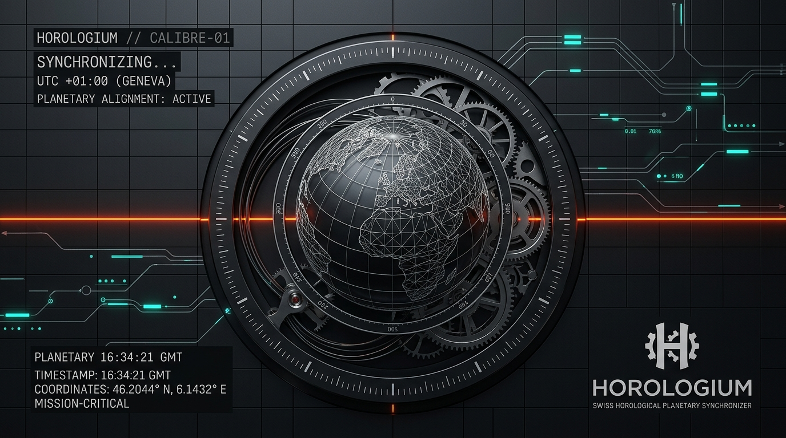

<p align="center">
  
</p>

# HOROLOGIUM // Planetary Time & Meridian Telemetry Architecture

> **An enterprise-grade, high-precision distributed chronometry system, interactive world timezone atlas, UTC meridian tracker, and telemetry platform engineered with Swiss horological precision, multi-engine persistence (Turso LibSQL, TimescaleDB & SQLite WAL), and an isolated Node.js API runtime.**

<p align="center">
  <a href="https://github.com/shaikimthiyas/horologium/actions/workflows/ci.yml">
    
  </a>
  
  
  
  
  
  
  <a href="LICENSE">
    
  </a>
</p>

---

## 1. System Overview

**Horologium** (named after the southern constellation *Horologium Oscillatorium* / "The Pendulum Clock") is a production-grade, distributed temporal telemetry platform engineered for low-latency operations, mathematical clock consensus, and high-availability global time visualization.

- **Zero-Latency Client-Side Chronometry:** Native `Intl.DateTimeFormat` and IANA database indexing eliminate third-party API rate limits and network dependency.
- **Marzullo Truechimer Consensus:** Multi-source atomic NTP evaluation filtering out rogue falsetickers to compute tight, provable intersection bounds.
- **Continuous Clock Slewing (Linux `adjtime` Emulation):** Smooth sub-millisecond drift adjustment preventing backwards time discontinuities.
- **Tri-Engine Persistence Architecture:** Native edge support for **Turso (LibSQL)**, enterprise **TimescaleDB / PostgreSQL 16**, and embedded high-performance **SQLite (WAL mode)** with in-memory test isolation.
- **Progressive Web App (PWA) Offline Engine:** Service Worker (v1.4.0) pre-caching all canonical consoles with synthetic offline API telemetry and **TCXO quartz drift simulation ($\pm 0.035\text{ ppm}$)**.
- **OpenAPI 3.1 Interactive Sandbox & Swagger UI:** Dual-mode developer explorer (`/api-explorer/`) featuring live execution against all endpoints and a downloadable Postman collection (`/horologium.postman_collection.json`).
- **Human-Factors & WCAG 2.2 AAA Compliance:** Mathematical contrast ratios ($\ge 7:1$), Fitts's law touch targets ($\ge 44\text{px}$), optical halation smoothing, and global accessible keyboard hotkeys.

---

## 2. Canonical Operational Consoles

Horologium is structured as an enterprise multi-page architecture with 6 specialized consoles accessible via the persistent Master Navigation Header:

| Console | Canonical Route | Primary Function | Shortcut |
| :--- | :--- | :--- | :---: |
| **Mission Gateway** | [`/`](index.html) | First-visit Calibre-01 auto-calibration, atomic dial, fast-path portal cards | <kbd>1</kbd> |
| **Flight Deck** | [`/flight-deck/`](flight-deck/index.html) | 3D WebGL globe & 2D Mercator cartography deck with dynamic solar terminator | <kbd>2</kbd> |
| **Geodesic Registry** | [`/geodesic-registry/`](geodesic-registry/index.html) | Sovereign meridian atlas and fuzzy query search across 220+ territories | <kbd>3</kbd> |
| **Operator Gateway** | [`/operator-gateway/`](operator-gateway/index.html) | Cryptographic clearance, telemetry station manager, and database persistence | <kbd>4</kbd> |
| **Protocol Liaison** | [`/protocol-liaison/`](protocol-liaison/index.html) | Transmission log dispatch, radio-frequency inquiries, and operator inbox | <kbd>5</kbd> |
| **API Explorer** | [`/api-explorer/`](api-explorer/index.html) | OpenAPI 3.1 Swagger UI sandbox, live latency tester, and Postman download | <kbd>6</kbd> |

---

## 3. High-Level System Architecture

```mermaid
graph TD
    User([🌐 Browser / Recruiter]) --> Gateway[Vite Dev :5173 / Node Gateway :3000]

    subgraph "Frontend Layer (Calibre-01 Sovereign HUD)"
        Gateway --> PWA[Service Worker v1.4.0<br/>• Offline Cache-First<br/>• Synthetic API Fallbacks]
        PWA --> Consoles[6 Canonical Consoles<br/>• Gateway, Flight Deck, Registry,<br/>  Operator, Liaison, API Explorer]
        Consoles --> FSM[ClockFSM Finite State Machine<br/>• 7 Deterministic States<br/>• TCXO Quartz Drift Simulation]
        Consoles --> WebGL[WebGL Context Loss & Recovery<br/>• Canvas Deallocation & Restore]
        Consoles --> Haptics[Web Audio Haptic Engine<br/>• Mechanical Audio Synthesizer]
    end

    subgraph "Backend API Gateway (server/app.js)"
        Gateway -- "/api/v1/*" --> ExpressApp[Express REST API Gateway]
        ExpressApp --> Limiter[Redis Sliding-Window Rate Limiter]
        ExpressApp --> Validator[Zod Schema Validator & RFC 7807 Details]
        ExpressApp --> Probes[Kubernetes Probes<br/>• /healthz, /readyz, /startupz]
        ExpressApp --> Metrics[Prometheus OpenMetrics Exposition<br/>• /metrics]
        ExpressApp --> SntpWS[WebSocket SNTP Server<br/>• RFC 4330 / RFC 5905]
    end

    subgraph "Persistence & Consensus Engines"
        ExpressApp --> Marzullo[Marzullo Truechimer Engine<br/>• Multi-NTP Intersection Consensus]
        ExpressApp --> TriDB[(Tri-Engine Persistence)<br/>• Turso LibSQL Cloud at Edge<br/>• TimescaleDB / PostgreSQL 16<br/>• Embedded SQLite WAL Mode]
    end
```

---

## 4. Core Mathematical Foundations

### A. Marzullo's Truechimer Consensus
To eliminate network falsetickers (servers reporting skewed or compromised time), Horologium queries multiple Stratum-1 reference peers (Cloudflare, NIST, pool.ntp.org) and calculates the optimal consensus intersection:

$$\text{Best Interval} = \left[ \max_{i} (c_i - \theta_i), \min_{j} (c_j + \theta_j) \right]$$

where $c_i$ is reference time and $\theta_i$ is symmetric uncertainty ($d_i / 2 + \epsilon_i$).

### B. Linux `adjtime` Monotonic Clock Slewing
When offset $\Delta t < 500\text{ ms}$, Horologium avoids abrupt time steps by slewing time at a controlled slew rate $\pm 0.5\text{ ms/s}$:

$$t_{\text{display}}(t) = t_{\text{local}}(t) + \text{offset}_{\text{base}} + \int_0^t S(\tau) \, d\tau$$

strictly guaranteeing monotonicity: $\frac{d}{dt} t_{\text{display}}(t) > 0$.

### C. Parabolic Quartz Oscillator Thermal Drift (Offline TCXO)
When disconnected from NTP (`ClockState.OFFLINE`), Horologium simulates quartz crystal resonance deviation:

$$\frac{\Delta f}{f} = -0.034\,\text{ppm}/^\circ\text{C}^2 \cdot (T - T_0)^2 + \text{aging}$$

calculating real-time cumulative drift: $\text{Drift}_{\text{ms}} = \frac{\Delta f/f \cdot \Delta t_{\text{sec}}}{1000}$.

---

## 5. Repository File Structure

```text
horologium/
├── .github/                      # Enterprise CI/CD pipelines & issue templates
│   └── workflows/ci.yml          # GitHub Actions test & build matrix (Node 20/22, Go 1.22)
├── api-explorer/                 # Interactive OpenAPI 3.1 Swagger UI & Telemetry console
│   └── index.html                # Dual-view HUD and Swagger UI live sandbox
├── deploy/                       # Production infrastructure & observability configs
│   ├── grafana/                  # Preconfigured Grafana dashboards & Prometheus datasource
│   └── prometheus/               # Prometheus scraping configuration (scrape_interval: 5s)
├── docs/                         # Comprehensive engineering documentation & audits
│   ├── architecture/             # Design tokens, CSS specs, and system architecture
│   │   ├── DESIGN_SYSTEM.md      # Calibre-01 tokens, typography, and optical rules
│   │   └── SYSTEM_ARCHITECTURE.md# Full-stack architectural specification
│   └── audit/                    # Executive audits and compliance matrices
│       ├── EXECUTIVE_SUMMARY.md  # Architectural executive audit
│       ├── MASTER_PRODUCTION_STANDOUT_CHECKLIST.md # Full maturity audit checklist
│       └── REQUIREMENT_TRACEABILITY_MATRIX.md     # 100% curriculum compliance matrix
├── flight-deck/                  # Planetary cartography & 3D WebGL globe console
├── geodesic-registry/            # Sovereign territory directory & geodesic search
├── operator-gateway/             # Cryptographic operator clearance & station hub
├── protocol-liaison/             # Operator inquiry & transmission dispatch queue
├── public/                       # Static production assets, branding, and manifest
│   ├── cover.jpg                 # High-resolution visual branding (2752×1536)
│   ├── horologium.postman_collection.json # Official Postman collection (v2.1.0)
│   ├── manifest.webmanifest      # PWA Web App Manifest (standalone, shortcuts)
│   ├── openapi.json              # OpenAPI 3.1.0 specification
│   └── sw.js                     # Service Worker (v1.4.0) with offline synthetic fallbacks
├── server/                       # Backend Node.js Express Gateway
│   ├── app.js                    # Express application orchestrator & probe aliases
│   ├── cache/                    # Redis client & distributed rate limiters
│   ├── db/                       # Tri-engine database layer (Turso, Timescale, SQLite)
│   ├── middleware/               # RFC 7807 Problem Details, Zod validator, Probes
│   ├── routes/                   # Central REST API router
│   └── services/                 # Marzullo truechimer NTP & WebSocket SNTP engine
├── src/                          # Frontend Calibre-01 client logic & state
│   ├── components/navigation/    # MasterHeader HUD & global keyboard shortcut chassis
│   ├── styles/                   # Vanilla CSS tokens, layout, and optical halation rules
│   └── utils/                    # ClockFSM, PWAManager, ErrorBoundary, AudioHaptics
├── tests/                        # Automated test suites (node:test)
│   ├── integration/              # Health probes and API integration tests
│   └── unit/                     # Marzullo, Slewing, ClockFSM, PWA, Swagger, WCAG tests
├── CHANGELOG.md                  # Semantic Versioning release notes (v1.0.0 - v1.4.0)
├── CONTRIBUTING.md               # Contribution guidelines & branch conventions
├── docker-compose.yml            # Multi-container stack (Gateway, Timescale, Redis, Prom, Graf)
├── Dockerfile                    # Multi-stage production container build (Go + Node)
├── LICENSE                       # MIT Open Source License
├── package.json                  # Dependencies, scripts, and module metadata
├── README.md                     # Executive project presentation
├── SECURITY.md                   # Security vulnerability reporting policy
├── server.js                     # Production entrypoint with graceful shutdown draining
└── vite.config.js                # Vite multi-page build configuration
```

---

## 6. Quick Start & Local Execution

### Prerequisites
- **Node.js**: `>= 20.10.0`
- **Docker & Docker Compose** (Optional, for full observability stack)

### A. Local Development Run
```bash
# 1. Clone repository
git clone https://github.com/shaikimthiyas/horologium.git
cd horologium

# 2. Install dependencies
npm install

# 3. Start Client & Server concurrently
npm run dev
```
- Client Frontend: `http://localhost:5173/`
- Backend API Gateway: `http://localhost:3001/`
- Health Probe: `http://localhost:3001/healthz`
- Swagger UI Explorer: `http://localhost:5173/api-explorer/`

### B. Run Automated Test Suites
```bash
# Execute all 74 unit, integration, and chaos engineering tests
npm test
```

### C. Build Production Bundle
```bash
# Compile multi-page Vite bundle to dist/
npm run build
```

### D. Multi-Container Production Stack (Docker Compose)
```bash
# Spin up Gateway, TimescaleDB, Redis, Prometheus, and Grafana
docker compose up -d --build
```
- Gateway: `http://localhost:3000`
- Prometheus: `http://localhost:9090`
- Grafana: `http://localhost:3002` (admin / horologium)

---

## 7. Deep Architectural Documentation

- 📄 [Executive Engineering Audit](docs/audit/EXECUTIVE_SUMMARY.md)
- 📋 [Requirement Traceability Matrix](docs/audit/REQUIREMENT_TRACEABILITY_MATRIX.md)
- 🎯 [Master Production Standout Checklist](docs/audit/MASTER_PRODUCTION_STANDOUT_CHECKLIST.md)
- 🎨 [Calibre-01 Design System & Typography](docs/architecture/DESIGN_SYSTEM.md)
- 🏛️ [System Architecture & Roadmap](docs/architecture/SYSTEM_ARCHITECTURE.md)
- 📮 [Postman Collection](public/horologium.postman_collection.json)

---

## 8. License & Governance

This project is open-source under the terms of the **[MIT License](LICENSE)**.  
For security concerns or vulnerability reports, please review our **[Security Policy](SECURITY.md)**.
